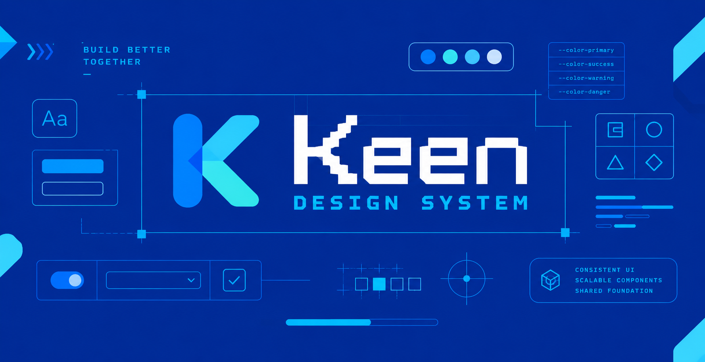

  

# Keen

Keen is a shared, themeable design system. It gives every project the same component core while each product keeps its own visual identity.

The name suggests curiosity and attentiveness.

**Status:** pre-alpha. Milestone 1 (AI chat in portfolio-blog) is in progress, and its stack, token, and distribution decisions are settled. Decisions are recorded in [docs/decisions.md](docs/decisions.md) as they land, and the research behind them is in [docs/research.md](docs/research.md).

## Project vision

Build a design system with a stable shared component core that each consuming product customizes through its own theme. The same components should work across projects like Job Scout, Brain CLI, Kid Coins, and the portfolio blog, with each project providing its own brand tokens and visual treatment.

Keen is also a learning and portfolio project. It documents the engineering decisions behind the system: component architecture, design tokens, theming, accessibility, usage guidance, and how AI tools can work with design-system knowledge.

## Milestone 1: AI chat in portfolio-blog

The first milestone is a reusable AI chat experience integrated into the portfolio blog. It proves that Keen components can be shared with another project and themed to fit its design.

The chat work establishes:

- A product-independent component API and interaction model.
- Conversation states, defined in the [chat contract](docs/components/chat.md). Stopped by user and error mid-stream keep the partial response.
- Theme customization through tokens provided by the host project.
- Responsive layouts and accessible keyboard and focus behavior.
- Integration guidance showing how portfolio-blog consumes and themes the component.

Keen owns the chat UI and its interaction behavior. The host owns the AI model, provider, credentials, and conversation persistence, and connects them through props or adapters.

### Done when

- Every conversation state renders and is reachable in an example: empty, loading, streaming, completed, error, stopped by user, error mid-stream, rate limited, and offline.
- The chat meets WCAG 2.1 AA.
- Streamed text is announced through a polite `aria-live` region, without re-reading the whole message.
- Focus returns to the input after a message is sent.
- Stop generation works from the keyboard.
- portfolio-blog renders the chat with its own tokens and no changes to Keen's component code.

### Decisions

Settled, with the reasoning in [docs/decisions.md](docs/decisions.md):

- Components are written in React, which fits portfolio-blog's Astro 5 and React 19 islands.
- Hosts install Keen as a pinned package build and never copy or edit component source.
- Hosts customize through themes only: semantic and component tokens, plus the variants and slots each component names.
- DTCG JSON is the one hand-edited token source; CSS custom properties and TypeScript exports are generated from it.
- Every token name carries its tier (`color.semantic.action`), and components never read primitive tokens.
- The repository is a pnpm workspace with tokens, the `keen` package, a token generator, docs, Storybook, and an Astro fixture app.
- Storybook reviews the implementation; Pen reviews the visual design and is never a token source.

Still open:

- Which accessible primitives library Keen builds on.
- Whether Brain CLI stays a consumer, and what Keen offers it.
- The component metadata format behind "AI-ready".

Each is recorded in [docs/decisions.md](docs/decisions.md) when it lands.

## AI-ready design-system knowledge

Keen makes design decisions understandable to both engineers and AI agents. Component documentation connects each component's purpose, anatomy, variants, states, behavior, accessibility requirements, usage guidance, and token dependencies.

An MCP interface is the planned way for AI tools to retrieve component and foundation guidance when building or adapting interfaces. Milestone 1 proves the chat component is useful and reusable first. MCP builds on that structured source of truth.

## Guiding principles

- **Shared core, product-owned theme:** Reuse structure and behavior while letting each product express its brand.
- **Useful before broad:** Prove the approach with AI chat before building a large component catalog.
- **Accessible by default:** Treat keyboard, focus, responsive, and assistive-technology behavior as part of component design.
- **Document decisions with the code:** Keep implementation, tokens, examples, and usage guidance connected.
- **Build for people and AI:** Make design knowledge easy to find and apply.

## Longer-term direction

After the portfolio-blog integration, validate the same components in more repositories. Grow the system from demonstrated reuse, then add or refine token tooling, package distribution, component documentation, and MCP retrieval as the project needs them.

## Tracking

Work is tracked in Linear under the Keen Design System project. Branches use Linear's issue branch names, and PRs reference their issue (for example, `Fixes HIE-18`) so status updates on merge.

## Brand assets

- [`keen-mark.svg`](docs/assets/keen-mark.svg): the K mark, for favicons and avatars.
- [`keen-logo.svg`](docs/assets/keen-logo.svg): the mark and wordmark lockup.
- [`keen-banner.png`](docs/assets/keen-banner.png): the README hero image only, since it is a raster render.

The SVG colors are CSS custom properties (`--keen-k1` to `--keen-k4`, `--keen-bg`, `--keen-ink`, `--keen-accent`), so an inline logo themes the same way Keen's components do.

## License

[MIT](LICENSE)
